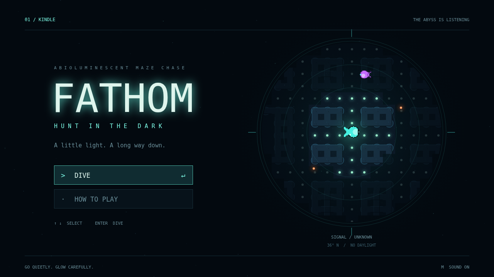

# Fathom — Kindle

**A little light. A long way down.**

Fathom is a bioluminescent deep-sea maze chase. Graze every plankton mote to
descend, use sonar to map the flooded corridors, and escape three hunters that
track light, sound, and the flash of their own flare.

In the **Kindle** dive, explored ground stays remembered, but you can see it only
through a circular window. Eating expands that window and brightens your light.
It also makes you easier to find. An amber glimmer might be a harmless drifter
worth 200 points—or a Lanternjaw wearing the same disguise.



## Run locally

Requires Node.js 22.12 or newer and npm.

```sh
npm ci
npm run dev
```

Open the local URL Vite prints. The game runs entirely in the browser, with no
backend, credentials, external fonts, or runtime services.

## Controls

| Control | Action |
| --- | --- |
| Arrow keys / WASD | Swim; release to stop. Turns buffer until a tile center. |
| Space | Send a sonar pulse. It reveals passages around corners but can alert Gloamfins. |
| Shift | Release ink to break a light-hunter's fix. |
| P / Escape | Pause / resume. |
| Up / Down, Enter / Space | Select and confirm menu items. |
| Escape | Go back. |
| M | Toggle sound on any screen. |
| Backtick | Toggle the engine's read-only diagnostics overlay. |

Menus also accept mouse and touch. Touching the game brings up the engine's
direction pad and action buttons: **A** is sonar, **B** is ink.

Clear all plankton for a 500-point bonus and the next depth. Depths add hunters
and shorten sonar range. Your three reserve lives are additional to the current
attempt. A catch preserves eaten plankton, your score, and the maze's remembered
terrain.

## Production build

```sh
npm run build
npm run preview
```

`dist/` is the complete static site, including `index.html` and all seeded art.
Serve that directory as-is at a server root or beneath a sub-path ending in `/`.
All runtime URLs are page-relative.

## Verification

```sh
npm run typecheck
npm run lint
npm run format
npm test
```

The tests instantiate the Simple 2D engine with a real in-process canvas,
scripted clocks, and dispatched input events. They exercise maze proportions,
frame-rate independence, continuous movement and wrapping, screen transitions,
visibility, hunting senses, cooldowns, scoring, catches, and descent. Coverage
and test reports are written to `coverage/`.

## Source map

- `src/game.ts`: engine registration, input, fixed-step accumulation, and public type exports.
- `src/model.ts`: complete state and debug contracts.
- `src/world.ts`: maze, center-line travel, shortest paths, state construction, and derived readings.
- `src/simulation.ts`: render-free 120 Hz simulation, senses, hunters, sonar, food, and progression.
- `src/debug.ts`: immutable scenario poses and JSON snapshots, available through `engine.debug`.
- `src/render.ts`: pixel-art maze and creatures, circular visibility mask, effects, menus, and HUD.
- `src/game.test.ts`: engine-driven unit tests.

The engine owns the browser loop, canvas fit, input, audio synthesis, asset
loading, recording, and diagnostic overlay. All evolving game data is held in
the engine's state value; rendering is read-only. The debug surface is returned
to the engine and is never installed on the page.

See [the showcase](showcase/showcase.md) for captured gameplay and its carousel.
