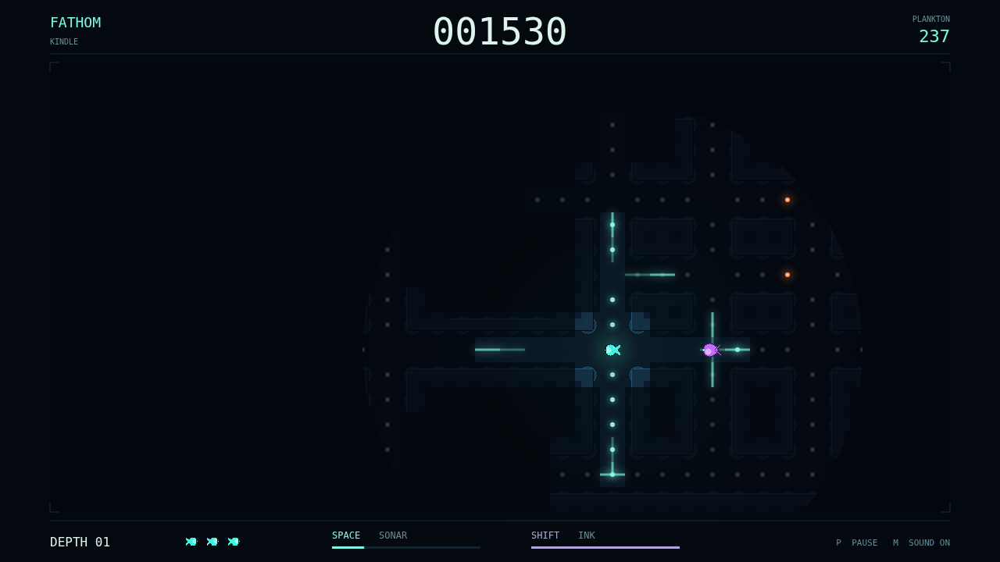

# Fathom

Far below daylight, a small forager carries the only light it can trust. Slip
through flooded corridors, graze the glowing plankton, and find your way through
a maze that appears only as you touch it with light. Clear the last mote and
descend into another depth, with your score intact and more hunters waiting.

Eating makes your glow—and your circular window into the abyss—grow. Old paths
stay in memory, but beyond that window even familiar water disappears into
black. Send a cyan sonar crest around a blind corner to sketch the route ahead
and catch a glimpse of what is coming toward you.

Three predators make every signal a decision. Lanternjaw follows your light,
disguised as the same amber jellyfish you might chase for a bonus. Eyeless
Gloamfin listens through stone and answers your sonar with its own violet ping.
Flarefish gives away its position in a rising glow before a sudden bloom burns
through the walls. An orange echo means a Gloamfin is searching where it last
heard you.

Swim quietly, turn sharply, and leave ink between yourself and the creatures
that see. You have three lives in reserve, a pocket of cold light, and the next
dark junction. How deep can you go?

